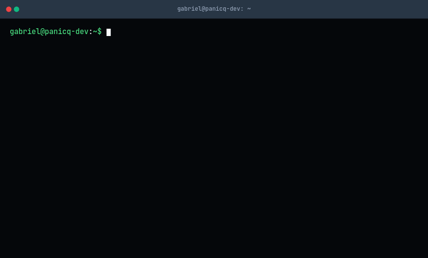

  

    

### Habilidades principais

### Estudando no momento...

### Projetos mais recentes
> [!IMPORTANT] 
> Veja alguns dos projetos que realizei recentemente!

- **[Desafio Itaú](https://github.com/panicq-dev/desafio-itau)** — Desenvolvimento de uma Web API em C#, acompanho de testes unitários dedicado ao projeto utilizando **xUnit** (`xUnitDesafioItau`).
- **[Desafio PicPay](https://github.com/panicq-dev/picpay-challenge)** — Implementação de serviços e regras de negócio para construção de um sistema de transação bancária, utilizando conceitos de Web Api, testes unitários com xUnit, Mock e Docker.
- **[Auth Service](https://github.com/panicq-dev/auth-api)** — Construção de uma robusta solução focada em autenticação, autorização e endpoint de segurança.

### Fale comigo!

    
    

<!--
     Oh, recruiters!
-->

### Recrutador?
> [!NOTE]  
> <a href="https://#/drive/folders/#?#" download>Baixe meu currículo</a>

